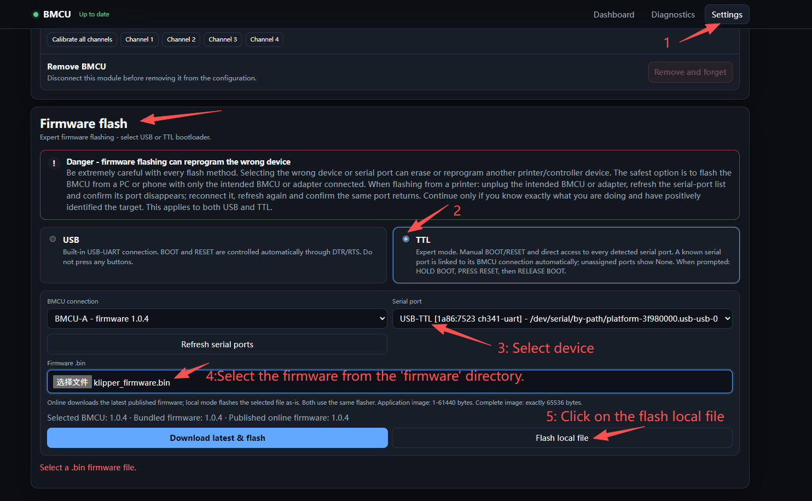
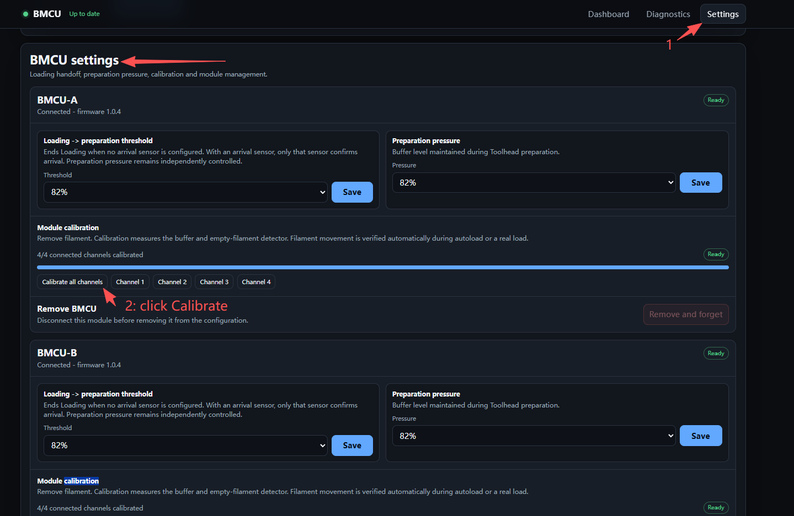
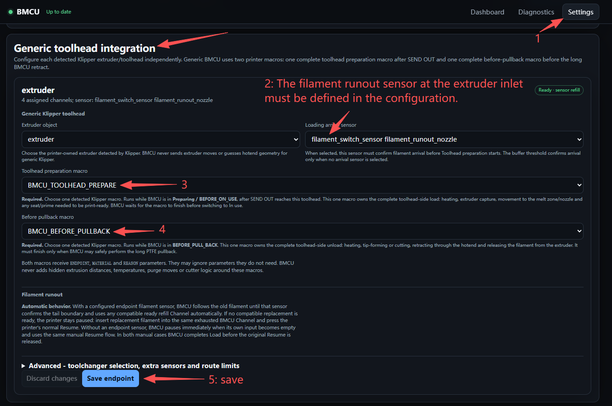
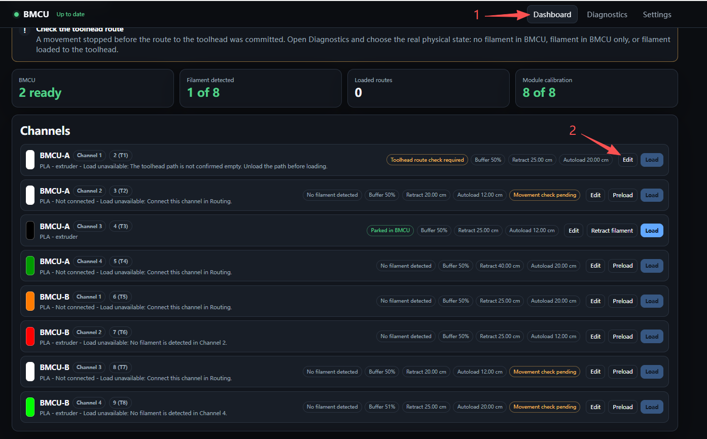
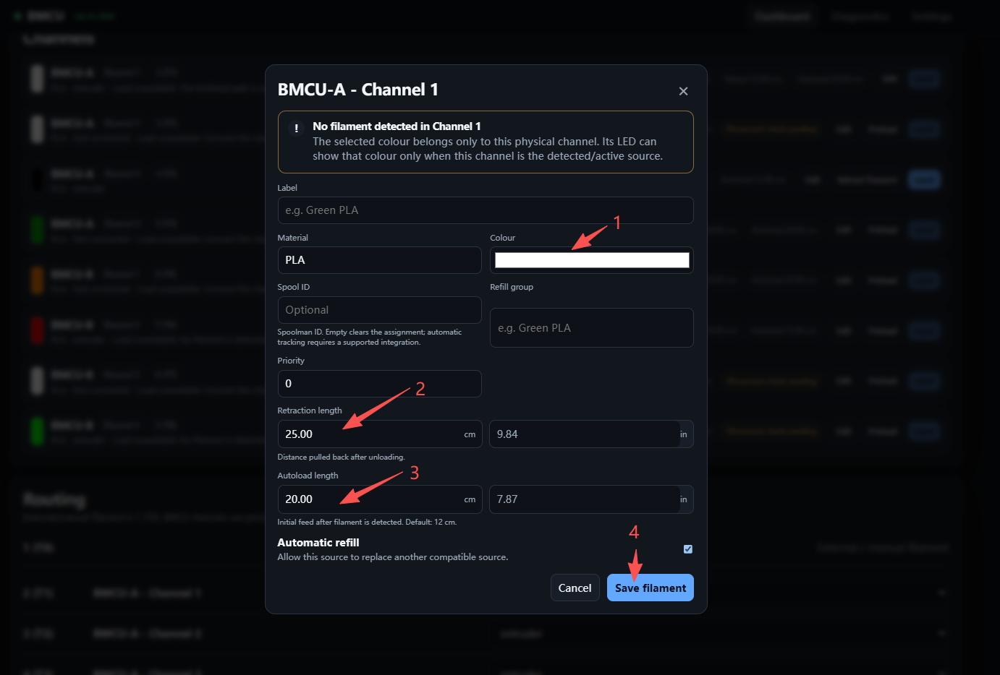
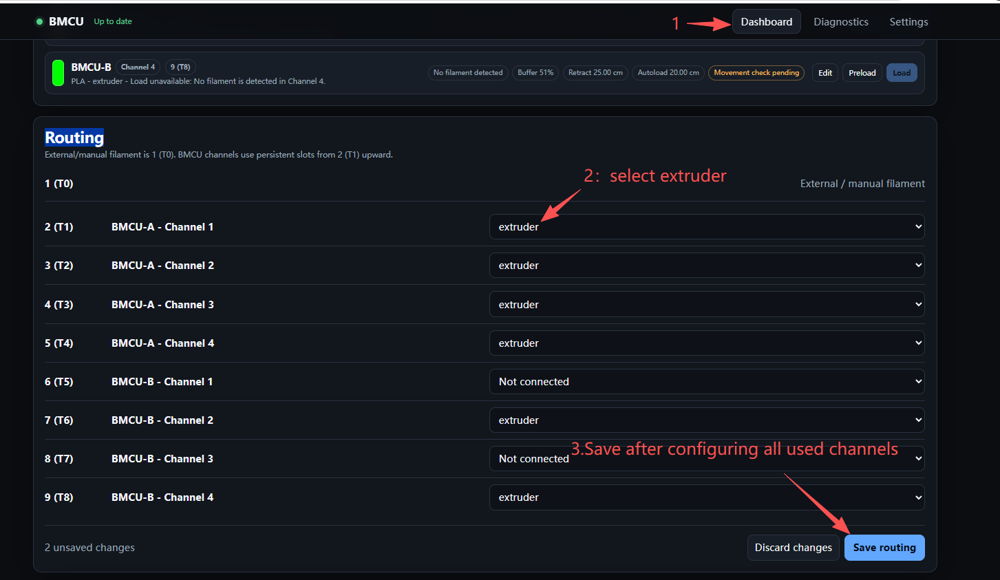
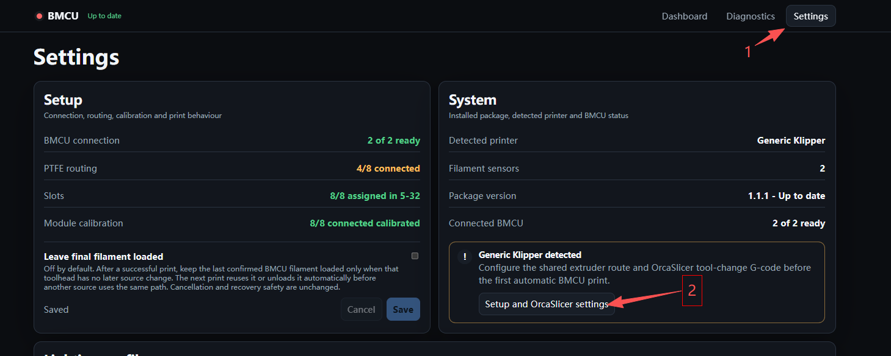
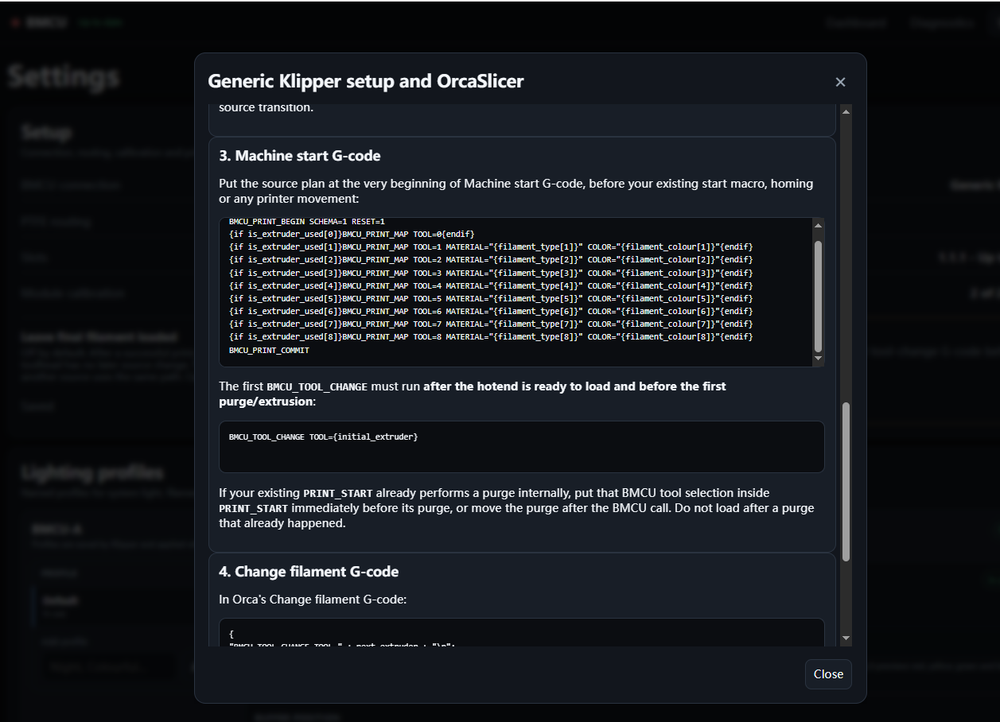

# BMCU-Klipper
# Introduction
This guide details the BMCU setup running official Klipper firmware, tested on a Voron 2.4 300.

# Install
```bash
curl -fsSL https://raw.githubusercontent.com/jarczakpawel/BMCU-Klipper/main/install.sh | sh
```
uninstall 
```bash
curl -fsSL https://raw.githubusercontent.com/jarczakpawel/BMCU-Klipper/main/install.sh | sh -s -- --uninstall
```

Once the installation prompts are complete, open the BMCU PANEL webpage:
http://PRINTER_IP:8291/

# Connection
- Connect 24V and GND between BMCU and machine.
- Connect the RX, TX, and GND pins of the USB-TTL module to the TX, RX, and GND pins of the BMCU.


# FLASH FIREWARE
- Select Flashing Mode and fireware
<p align="left">
  
</p>

- In the pop-up window, check all options and then enable Flash.
- Following the prompts on the page, press the BMCU's BOOT and RESET buttons.
- After the flashing process finishes, turn off the machine power. Disconnect the USB-TTL of the flashed BMCU from the Raspberry Pi, connect the unflashed one, and repeat the same steps to flash the firmware.

Once all BMCUs have been flashed, connect all the USB-TTL modules back to the Raspberry Pi.

# Calibration
- Click the calibration button to start the automatic 4-channel BMCU calibration.
<p align="left">
  
</p>

- When a channel's yellow light flashes, press down on the channel, hold for 1 second, and then release.
- When the red light flashes, pull up on the channel, hold for 1 second, and then release.

# Panel
## Generic toolhead integration
<p align="left">
  
</p>


## Channel Setting
<p align="left">
  
</p>

<p align="left">
  
</p>


## Routing
<p align="left">
  
</p>


# Config
Copy bmcu_user.cfg to the ~/printer_data/config/ directory, and append [include bmcu_user.cfg] to your printer.cfg file.


# OrcaSlicer Setting
<p align="left">
  
</p>
<p align="left">
  
</p>

- Printer Start G-code: Manually Modify Color Data
```bash
{if is_extruder_used[4]}BMCU_PRINT_MAP TOOL=3 MATERIAL="{filament_type[3]}" COLOR=000000{endif}
{if is_extruder_used[5]}BMCU_PRINT_MAP TOOL=6 MATERIAL="{filament_type[6]}" COLOR=FF0000{endif}
{if is_extruder_used[8]}BMCU_PRINT_MAP TOOL=8 MATERIAL="{filament_type[8]}" COLOR=00FF00{endif}
```

Add "BMCU_TOOL_CHANGE TOOL={initial_extruder}"to the end of Start G-code.

- Modify Filament Change G-code
- Add Printer End G-code
- Under Printer --> Material Settings, uncheck both "Single Extruder Multi-Material" and "Manual Filament Change". Then, update the extruder count so that the total number of extruders equals the number of BMCU channels plus one
- Modify the information for all filaments


